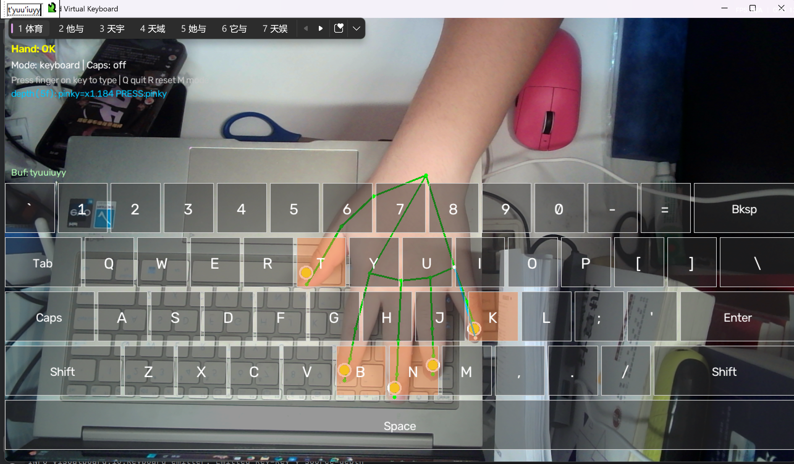
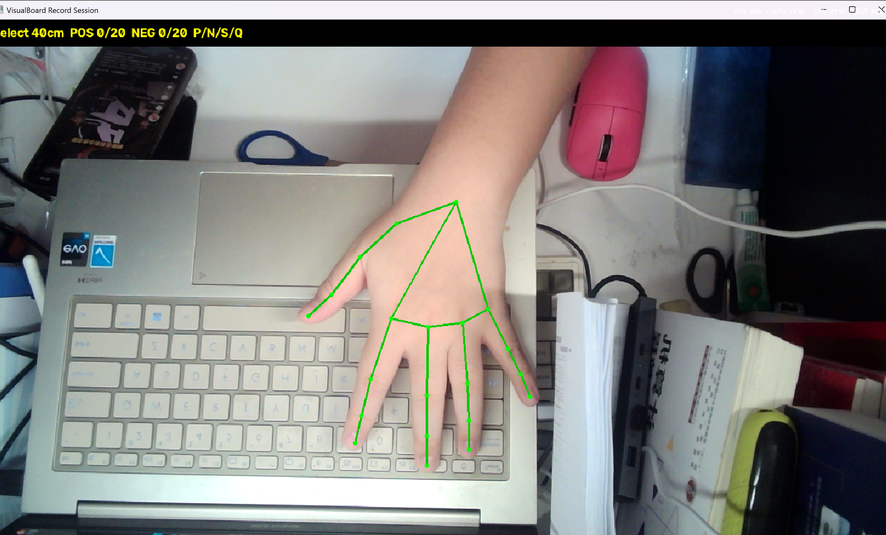
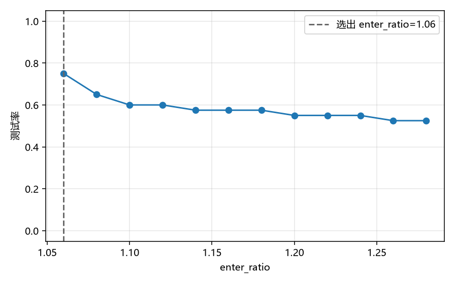
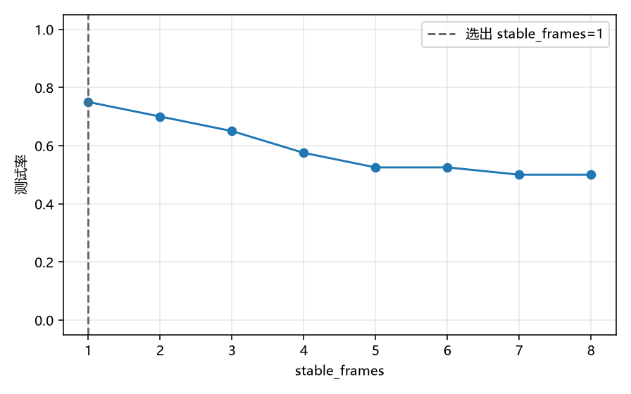
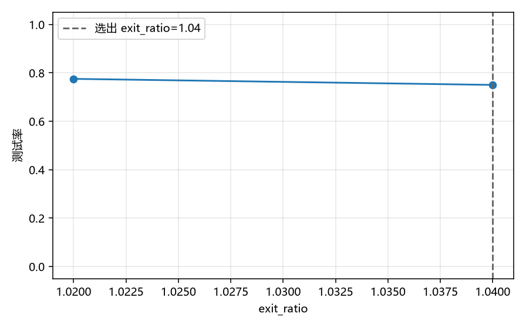
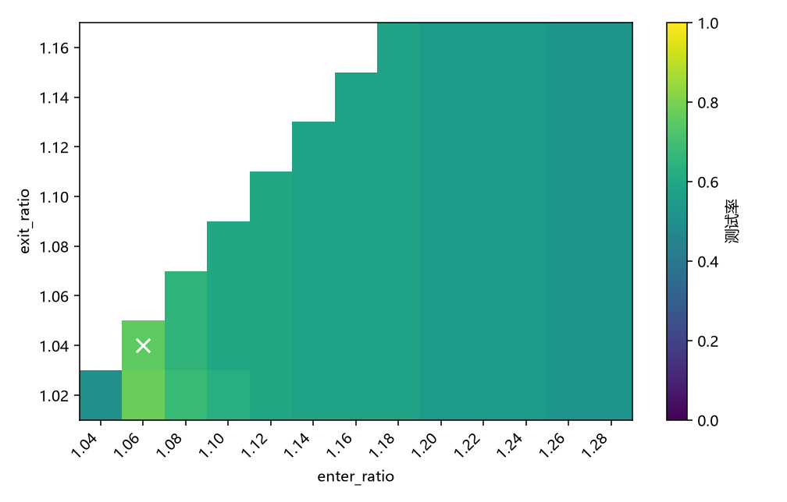

# **《计算机系统项目综合实践》课程报告**

**报告题目：** 基于单目表观尺寸变化的无接触虚拟键盘按压检测及其参数寻优

**组    长：班级：** 待实验者填写 **学号：** 待实验者填写 **姓名：** 待实验者填写  
**在本项实践中的贡献百分比：** 待实验者填写 %

**组  员1：班级：** 待实验者填写 **学号：** 待实验者填写 **姓名：** 待实验者填写  
**在本项实践中的贡献百分比：** 待实验者填写 %

**组  员2：班级：** 待实验者填写 **学号：** 待实验者填写 **姓名：** 待实验者填写  
**在本项实践中的贡献百分比：** 待实验者填写 %

**日    期：** 待实验者填写

---

## 一、课程实践目标和内容概述

### 1. 系统设计与功能、选题理由

本组实现 **VisualBoard**：单目摄像头识别手部，在屏幕虚拟键盘上悬停选键，用手指下压触发按键，再经 pynput 写入当前焦点窗口。默认主交互是俯视投影按压（`pinch_source: depth`，`direction: far`）。拇指–食指像素距离捏合保留为对照基线，不是默认触发方式。

功能包括 MediaPipe 手部跟踪、指尖 EMA、虚拟 QWERTY、五指投影按压、捏合对照、冷却与迟滞、键鼠模式切换。检测器本身不在本实验里重写。实验在一次真人录制上离线重放 `DepthPressDetector`。

选题理由：课程要求把算法优势和灵敏度调试写成可复现实验。俯视打字时捏合不自然，绝对像素阈值又随距离变化。相对表观尺寸给出一个可以扫、可以对照的工作点。

### 2. 开发语言与工具及理由

Python、OpenCV、MediaPipe Hands、NumPy、pynput、PyYAML。出图使用 matplotlib（安装 `pip install -e ".[dev,experiments]"`）。MediaPipe 提供 21 个关键点，本组把工作放在按压判决和参数实验上，不重新训练检测网络。

### 3. 性能如何评估

测试集不是图像分类库，也不是训练轮次。测试集是引导录制里划定的正样本段和负样本段，两者数量相同。空闲帧只更新滚动基线，不进分母。

- 正样本段内至少一次按压上升沿：TP，否则 FN。段内多余上升沿不重复计数。
- 负样本段内出现任何按压上升沿：FP，否则 TN。
- 测试率 \(=(TP+TN)/(TP+FN+FP+TN)\)。报告曲线的纵轴和选参目标都是这个量。
- Recall \(=TP/\) 正样本段数，FAR \(=FP/\) 负样本段数。
- 延迟是 TP 段起点到第一次匹配上升沿的平均时间。

深度上升沿是五指检测器 `active` 的或运算从假变真。`stable_frames` 已经在检测器内部生效。捏合上升沿使用 `interaction.pinch_stable_frames`（默认 3），不套用深度的 `stable_frames`。

最优刻度是网格上测试率最高的实测点，不拟合、不插值。最高与次高相差不超过 \(1/N\) 时视为平台。平台内依次取更低 FAR、更短延迟、更大的 `enter_ratio`、更大的 `stable_frames`、更小的 `exit_ratio`。`exit_ratio >= enter_ratio` 的格子丢弃。

满意线事先写在 `experiments/protocol.yaml`：测试率 ≥ 0.85 且 FAR ≤ 0.15。未达到就写未达到。

帧率用 `scripts/benchmark_fps.py` 另测，不混进测试率。

---

## 二、课程教学目标的理解与实施

### 1. 阶段划分与学科知识

| 阶段 | 知识或技术 |
|---|---|
| 调研 | 开源虚拟键盘的捏合与悬停 |
| 视觉管线 | OpenCV 采集、MediaPipe 21 点 |
| 按压算法 | 针孔关系下投影变短，相对基线，双阈值迟滞，中位数基线 |
| 系统集成 | 分层、事件、系统输入注入 |
| 实验 | 段标注、离线重放、坐标下降、测试率曲线 |
| 文档 | 协议与可追溯 CSV |

### 2. 重点与难点

重点是把下压写成可重放的判决，并用测试率曲线选出工作点。难点是单目没有深度、滚动基线会被按压污染（按压期间冻结）、下压时键位漂移（`latch_key`）、以及误触和漏检不能用一个没有约束的分数混在一起。

### 3. 影响因素与时间比例

影响因素：光照、机位、手是否在画面里、基线是否攒够、正负段是否按协议做。建议时间比例：调研 10%，算法与集成 40%，实验采集与分析 30%，文档 20%。组长与组员学时：待实验者填写。

### 4. 特长发挥

待实验者填写具体人名。代码上的分工对应模块：`depth_press` 与 `multi_finger_depth` 是判决，`main_loop` 是集成，`eval` 与 `scripts/sweep_params.py` 是实验，两份课程报告是文档。

### 5. 沟通与分工

默认交互定为俯视五指投影，捏合降为对照。选参规则写在 `experiments/protocol.yaml`，扫参之前就固定。没有 `data_kind=real` 的 CSV 时不写测试率和最优参数。会议记录：待实验者填写。

### 6. 新内容与自主学习

本组实际用到、课程未按这个项目讲过的内容：

- 针孔模型下用投影长度的相对变化代替深度，俯视时 `signal = baseline/value`。
- 进入阈值、退出阈值和连续帧确认组成的迟滞。
- 用正负样本段定义测试率、Recall、FAR，并规定平台上的取舍顺序。
- 坐标下降加一张 enter×exit 表，避免把局部工作点说成全网格最优。

---

## 三、计算机综合实践系统的具体实现

### 1. 样本与可视化

没有图像分类数据库，也没有神经网络训练集。样本是 `scripts/record_session.py` 里按键划定的段：

- P：1.5 秒正样本，手指向桌面下压再抬起。
- N：2.0 秒负样本，在键上方移动，不要下压。
- 各 20 段后按 S 保存。注释头为 `data_kind=real`，并写下距离、时间和分辨率。
- 每帧保存五指 MCP→TIP 投影长度和拇指–食指距离。丢手的帧长度为空，重放时按检测器现有规则喂入空值。



*图 3-2 主程序界面：手部骨架、悬停高亮和按压状态。*



*图 3-1 40 cm 选择会话的录制窗口。P/N 只负责给正负样本段计时。*

### 2. 系统结构、参数与模型原理

运行时数据流：摄像头 → MediaPipe 21 点 → 指尖 EMA 与五指投影按压 → 虚拟键盘命中 → 触发引擎 → pynput。

按压判决在 `src/visualboard/interaction/depth_press.py`。俯视 `direction=far` 时

\[
\mathrm{signal}=\mathrm{baseline}/\mathrm{value}
\]

`signal` 不小于 `enter_ratio` 且连续 `stable_frames` 帧后进入按压，低于 `exit_ratio` 退出。滚动基线是最近若干帧的中位数，按压期间不更新。`source=finger_length` 时五个手指各有一个检测器，见 `multi_finger_depth.py`。

MediaPipe Hands 只提供二维关键点。本组没有重新训练它。

默认参数（`config/default.yaml`）：

| 参数 | 含义 | 默认 |
|---|---|---|
| enter_ratio | 进入按压的相对变化 | 1.12 |
| exit_ratio | 退出按压的迟滞 | 1.06 |
| stable_frames | 连续确认帧 | 4 |
| ema_alpha | 指尖平滑 | 0.3 |
| cooldown_sec | 触发冷却 | 0.4 |
| pinch_source | 主路径 | depth |
| pinch_threshold_px | 对照用的捏合像素阈值 | 45 |
| pinch_stable_frames | 捏合确认帧，扫捏合时固定 | 3 |

`ema_alpha` 影响指尖位置，不进入这次按压测试率的横轴。三张单参数曲线是 `enter_ratio`、`stable_frames`、`exit_ratio`。

### 3. 实验过程

协议文件：`experiments/protocol.yaml`。初值就是上表的 enter、exit、stable。网格：

1. `enter_ratio` 从 1.04 到 1.28，步长 0.02。
2. `stable_frames` 为 1 到 8 的整数。
3. `exit_ratio` 从 1.02 到 1.16，步长 0.02，只保留小于 `enter_ratio` 的格子。
4. 用新的 stable 和 exit 再扫一次 enter。峰值不变则停止；变了就再做一轮，最多两轮。

然后在最终 `stable_frames` 上做 `enter_ratio × exit_ratio` 表。系统采用这张表里测试率最高的合法格，加上坐标下降得到的 `stable_frames`。若该格比坐标下降三元组高出 \(1/N\) 以上，两格都写入报告，并说明简化寻优可能停在局部工作点。

捏合在同一份 select 会话上扫描 `pinch_threshold_px` 25 到 80、步长 5。第二份 transfer 会话只重放两个已锁定工作点，不参与选参。

实验者在仓库根目录执行：

```powershell
pip install -e ".[dev,experiments]"
python scripts\record_session.py --distance-cm 40 --role select
python scripts\sweep_params.py --raw experiments\raw\session_select_40cm_时间戳.csv
python scripts\plot_curves.py
python scripts\fill_report.py
```

第二距离可选：

```powershell
python scripts\record_session.py --distance-cm 55 --role transfer
python scripts\sweep_params.py --raw <select.csv> --transfer <transfer.csv>
```

`config/optimal_overlay.yaml` 只在 real 扫参之后生成，主程序不自动加载。没有 real CSV 时下面不放曲线，也不填测试率。

<!-- vb:curves:start -->
选择用会话：`experiments/raw/session_select_40cm_20261021_211329.csv`，距离 40 cm，正样本段 20、负样本段 20。坐标下降共 2 轮。下列曲线来自最后一轮。

图中纵轴是测试率。标出的点是该条曲线按平台规则选出的刻度，不是插值。



*图 3-4 测试率随 enter_ratio 变化。该曲线选出的刻度为 enter_ratio=1.06，测试率 0.7500，TP/FN/FP/TN = 11/9/1/19。*



*图 3-5 测试率随 stable_frames 变化。该曲线选出的刻度为 stable_frames=1，测试率 0.7500，TP/FN/FP/TN = 11/9/1/19。*



*图 3-6 测试率随 exit_ratio 变化。该曲线选出的刻度为 exit_ratio=1.04，测试率 0.7500，TP/FN/FP/TN = 11/9/1/19。*



*图 3-7 测试率随 enter_ratio 与 exit_ratio 变化。表中测试率最高的合法格为 enter_ratio=1.06，exit_ratio=1.04，测试率 0.7500。非法格（exit ≥ enter）没有画出。*
<!-- vb:curves:end -->

---

## 四、实验结果分析和结论

物理关系上，`enter_ratio` 偏小会让负样本段里的噪声跨过阈值，FAR 上升，测试率下降；偏大则正样本段的 `signal` 不够，Recall 下降，测试率同样下降。这是曲线形态的解释框架。具体格子上的 TP、FN、FP、TN 只能来自真人 sweep。

<!-- vb:conclusions:start -->
每个数对应 `experiments/sweeps/` 里同一参数组合的一行，会话为 `experiments/raw/session_select_40cm_20261021_211329.csv`。

| 工作点 | 参数 | TP | FN | FP | TN | 测试率 | Recall | FAR | 延迟 |
|---|---|---|---|---|---|---|---|---|---|
| 坐标下降三元组 | enter_ratio=1.06, exit_ratio=1.04, stable_frames=1 | 11 | 9 | 1 | 19 | 0.7500 | 0.5500 | 0.0500 | 0.5629 s |
| 热力表采用格（系统采用） | enter_ratio=1.06, exit_ratio=1.04, stable_frames=1 | 11 | 9 | 1 | 19 | 0.7500 | 0.5500 | 0.0500 | 0.5629 s |
| contact 工作点 | pinch_threshold_px=25.0 | 0 | 20 | 0 | 20 | 0.5000 | 0.0000 | 0.0000 | 无 TP |

热力表最高格相对坐标下降三元组的测试率提升不超过 1/N。系统采用的 enter_ratio 与 exit_ratio 仍取热力表最高合法格，stable_frames 取坐标下降结果。

系统采用格的测试率为 0.7500，FAR 为 0.0500，未达到满意线（测试率 ≥ 0.85 且 FAR ≤ 0.15）。

enter_ratio 曲线的选出刻度是 1.06。更大的刻度里，Recall 最低出现在 1.26（Recall 0.0500，测试率 0.5250）。正样本段更容易漏检。

同一会话上，depth 采用格测试率 0.7500、Recall 0.5500、FAR 0.0500；contact 工作点（pinch_threshold_px=25.0）测试率 0.5000、Recall 0.0000、FAR 0.0000。这是同一批正负段、同一条平台规则下的比较，不是显著性检验。

第二距离：未采集。
<!-- vb:conclusions:end -->

捏合网格从 25 到 80 的每一格都是 TP=0、TN=20。测试率相同时平台规则取更小的 `pinch_threshold_px`，所以接触工作点写成 25。这次正样本是手指向下压，不是拇指与食指捏合，接触通路没有在正样本段里形成上升沿。

尚未做：第二距离、多名实验者、多种光照，以及把延迟写进满意线。姓名、学号、学时和第五节感想仍待实验者填写。

---

## 五、课程教学目标的实现程度评估

本组已经用 40 cm 的真人会话完成扫参和出图。采用格是 enter_ratio=1.06、exit_ratio=1.04、stable_frames=1，测试率 0.75，FAR 0.05，没有达到事先写定的满意线。第二距离没有录。姓名、学时和个人感想仍空着。

个人感想：待实验者填写。

对老师的建议：待实验者填写。

---

## 附录：实验者清单

1. 三脚架俯视、补光，约 40 cm。运行 `python scripts/record_session.py --distance-cm 40 --role select`。P 为向桌面下压再抬起，N 为移动但不要下压。各 20 段后按 S。
2. 有时间再把摄像头放到约 55 cm，录之前不要改参数：`python scripts/record_session.py --distance-cm 55 --role transfer`。
3. 截主界面和录制或调参界面，存为 `experiments/figures/S2_main_ui.png`、`experiments/figures/S3_record_or_tune.png`。
4. 填写姓名、学号、班级、贡献、学时、日期，以及第五节感想。
5. 保存完成后说明「真人 CSV 已放好」。然后只对 `data_kind=real` 的文件运行扫参、出图和 `fill_report.py`。CSV 里没有的数继续留空。
